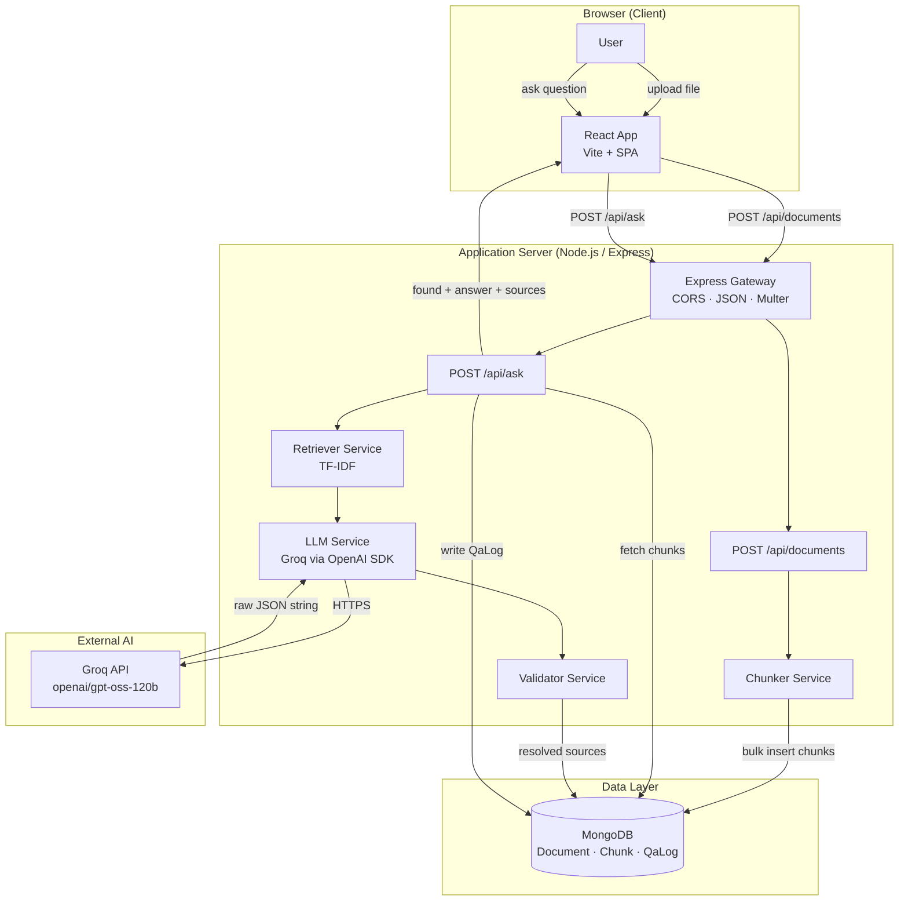
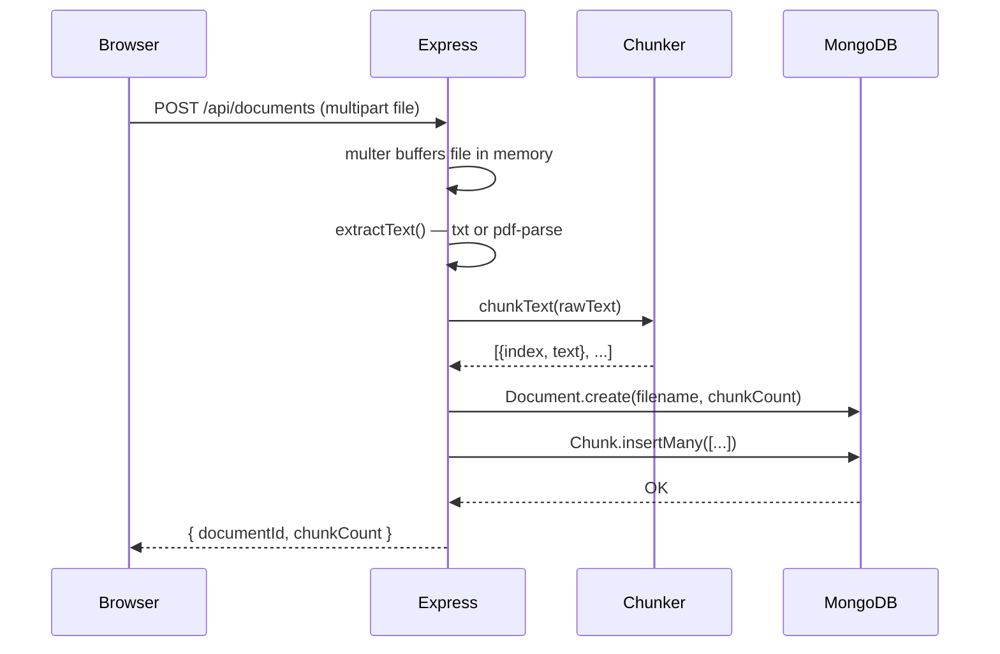
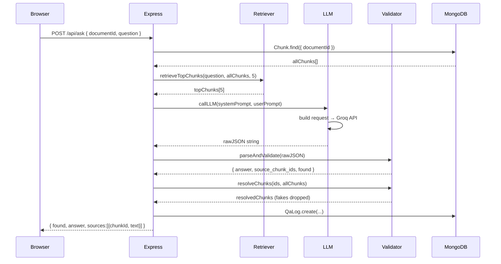
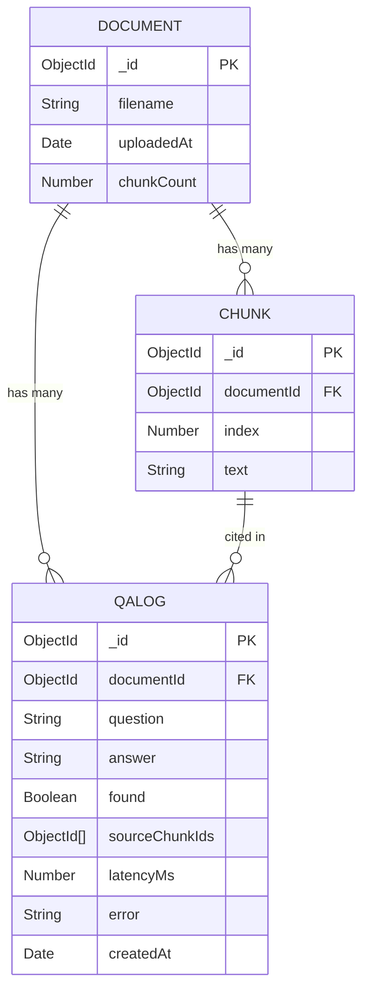
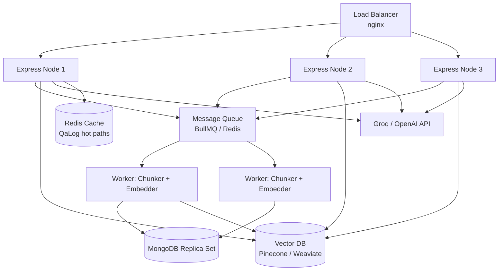

# AskMyDoc — Interview-Ready Technical Design Document

## Table of Contents
1. Problem Statement & Requirements
2. High-Level Design (HLD)
3. Low-Level Design (LLD)
4. Database Design
5. API Design
6. Algorithm Deep Dive
7. Design Decisions & Tradeoffs
8. Scalability & Future Architecture
9. Security Model
10. Error Handling Strategy
11. Performance Considerations
12. Interview Q&A Bank

---

## 1. Problem Statement & Requirements

### Functional Requirements
| # | Requirement |
|---|-------------|
| FR1 | User can upload a `.txt` or `.pdf` document (≤ 10 MB) |
| FR2 | User can ask natural language questions about the document |
| FR3 | System answers using **only** content from the uploaded document |
| FR4 | Every answer includes the exact source passage(s) that support it |
| FR5 | If the answer is not in the document, system says so explicitly |
| FR6 | False-premise questions are handled without validating the false claim |
| FR7 | Every question is logged with latency, result, and error details |

### Non-Functional Requirements
| # | Requirement | Target |
|---|-------------|--------|
| NFR1 | Response latency | < 5 seconds end-to-end (P95) |
| NFR2 | File upload size | ≤ 10 MB |
| NFR3 | No client-side secrets | API key never leaves the server |
| NFR4 | Grounding guarantee | Source text always from DB, never from model |
| NFR5 | Fault tolerance | Retry on rate limit / 5xx; JSON parse retry |
| NFR6 | Observability | QaLog captures every interaction |

### Out of Scope (MVP)
- Multi-user authentication / user accounts
- Document history / library management
- Vector embeddings / semantic search
- Real-time streaming responses
- Multi-document cross-referencing

---

## 2. High-Level Design (HLD)

### System Architecture Diagram



### Component Interaction (Upload Flow)



### Component Interaction (Ask Flow)



### Technology Stack Rationale

| Layer | Technology | Why chosen |
|-------|-----------|------------|
| Frontend | React + Vite | Fast HMR, small bundle, SPA routing |
| Backend | Express (Node.js) | Non-blocking I/O suits LLM wait times; JS isomorphism |
| Database | MongoDB | Schema-flexible for evolving models; document-oriented fits chunks |
| ODM | Mongoose | Schema validation, middleware, typed models |
| File upload | Multer | De-facto standard, memory storage (no disk I/O) |
| PDF parsing | pdf-parse | Lightweight, pure-JS, no system dependencies |
| LLM SDK | openai npm package | Works with any OpenAI-compatible endpoint (Groq, xAI, DeepSeek) |
| LLM Provider | Groq | Free tier, OpenAI-compatible, fast inference |
| Dev server | Node --watch | Zero extra tooling for hot reload |

---

## 3. Low-Level Design (LLD)

### Module Dependency Graph

```
index.js
  └── routes/documents.js
        ├── models/Document.js
        ├── models/Chunk.js
        └── services/chunker.js

  └── routes/ask.js
        ├── models/Chunk.js
        ├── models/QaLog.js
        ├── services/retriever.js
        ├── services/llm.js
        └── services/validator.js
```

### Service Contracts (Interfaces)

#### `chunker.js`
```js
/**
 * Input:  string (raw document text)
 * Output: Array<{ index: number, text: string }>
 * Side effects: none
 * Throws: never
 */
function chunkText(text: string): Chunk[]
```

#### `retriever.js`
```js
/**
 * Input:  question string, array of Chunk DB objects, topN count
 * Output: top-N Chunk objects sorted by TF-IDF score descending
 * Side effects: none
 * Throws: never (returns first N on empty query)
 */
function retrieveTopChunks(question: string, chunks: Chunk[], topN: number): Chunk[]
```

#### `llm.js`
```js
/**
 * Input:  system prompt string, user prompt string
 * Output: raw model response string (expected to be JSON)
 * Side effects: HTTP call to Groq API
 * Throws: tagged Error with .type = TIMEOUT | BAD_KEY | RATE_LIMIT | SERVER_ERROR | UNKNOWN
 */
async function callLLM(systemPrompt: string, userPrompt: string): Promise<string>
```

#### `validator.js`
```js
/**
 * parseAndValidate
 * Input:  raw model response string
 * Output: { answer: string, source_chunk_ids: string[], found: boolean }
 * Throws: tagged Error with .type = MALFORMED_JSON | INVALID_SCHEMA
 */
function parseAndValidate(rawText: string): ValidatedResponse

/**
 * resolveChunks
 * Input:  array of IDs from model, array of DB chunk objects
 * Output: only the chunks whose _id is in the IDs array
 * Side effects: none (silently drops fake IDs)
 */
function resolveChunks(ids: string[], dbChunks: Chunk[]): Chunk[]
```

### Chunking Algorithm — Detailed

```
Input: "The quick brown fox jumps over the lazy dog. ..."

1. Trim and split on whitespace → words[]
2. start = 0
3. Loop:
   a. end = min(start + 300, words.length)
   b. chunkText = words[start..end].join(' ')
   c. push { index: chunks.length, text: chunkText }
   d. if end == words.length → break
   e. start += (300 - 50) = 250   ← slide by TARGET - OVERLAP

Complexity: O(n) time, O(n) space where n = word count
```

**Overlap benefit illustration:**
```
Chunk 2 ends:    "...the contract terminates after 30"
Chunk 3 starts:  "after 30 days of written notice..."

→ Question "How many days notice?" retrieves BOTH chunks
  because "days" and "notice" appear in chunk 3,
  but full context spans the boundary
```

### TF-IDF Algorithm — Detailed

```
For question Q and chunk set C:

1. tokenize(Q)   → query_tokens (stop words removed, lowercased)
2. For each chunk c:
   tokenize(c.text) → chunk_tokens
3. Build IDF map:
   for each qt in query_tokens:
     df[qt] = count of chunks where qt appears
     idf[qt] = log((|C| + 1) / (df[qt] + 1)) + 1   ← smooth IDF

4. Score each chunk c:
   tf_map = termFreq(tokenize(c.text))
   score(c) = Σ (tf_map[qt] / len(c.tokens)) * idf[qt]
              for qt in query_tokens

5. Sort chunks by score descending → return top 5

Complexity: O(|C| × |Q|) where |C|=chunks, |Q|=query tokens
```

**Why smooth IDF?** `log((N+1)/(df+1)) + 1` prevents division by zero when a term appears in every chunk, and the `+1` additive smoothing ensures rare terms get higher weight without going to infinity.

### Validator State Machine

```
raw string
    │
    ▼
Strip ``` fences
    │
    ▼
JSON.parse()
    ├── FAIL → throw MALFORMED_JSON
    └── OK
         │
         ▼
typeof found === 'boolean'?
    ├── NO  → throw INVALID_SCHEMA
    └── YES
         │
         ▼
found === true AND (answer empty)?
    ├── YES → throw INVALID_SCHEMA
    └── NO
         │
         ▼
Array.isArray(source_chunk_ids)?
    ├── NO  → throw INVALID_SCHEMA
    └── YES → return { answer, source_chunk_ids, found }
```

### Retry Logic Flow

```
callLLM()
    │
    attempt 0
    │
    ├── SUCCESS → return content
    │
    ├── TIMEOUT (AbortError) → throw TIMEOUT immediately (no retry)
    ├── 401 BAD_KEY          → throw BAD_KEY immediately (no retry)
    ├── 429 RATE_LIMIT       → wait 1500ms → attempt 1
    └── 5xx SERVER_ERROR     → wait 1500ms → attempt 1
              │
              attempt 1
              │
              ├── SUCCESS → return content
              ├── 429 RATE_LIMIT → throw RATE_LIMIT (max retries)
              └── 5xx → throw SERVER_ERROR (max retries)

JSON parse failure in route:
    attempt 0 fails → retry with corrective nudge → attempt 1
    attempt 1 fails → throw MALFORMED_JSON to client
```

---

## 4. Database Design

### Collections & Schemas

#### `documents`
```json
{
  "_id":        "ObjectId",
  "filename":   "String (required)",
  "uploadedAt": "Date (default: now)",
  "chunkCount": "Number (required)"
}
```

#### `chunks`
```json
{
  "_id":        "ObjectId",
  "documentId": "ObjectId (ref: Document, indexed)",
  "index":      "Number (0-based position in doc)",
  "text":       "String (300-word segment)"
}
```
**Index:** `documentId` is indexed — every `ask` query does `Chunk.find({ documentId })` so this is critical.

#### `qalogs`
```json
{
  "_id":           "ObjectId",
  "documentId":    "ObjectId",
  "question":      "String",
  "answer":        "String",
  "found":         "Boolean",
  "sourceChunkIds":"[ObjectId]",
  "latencyMs":     "Number",
  "error":         "String | null",
  "createdAt":     "Date"
}
```

### Entity Relationship Diagram



### Why MongoDB over SQL?

| Factor | MongoDB | PostgreSQL |
|--------|---------|-----------|
| Chunk text storage | Natural document store | Works but verbose schema |
| Source ID arrays | Native array field | Junction table needed |
| Schema flexibility | Easy to add fields | Migration required |
| Scale-out | Horizontal sharding built-in | Requires read replicas |
| Query pattern | `find({ documentId })` | `WHERE document_id = ?` |

Both would work — MongoDB was chosen for its natural fit with variable-length text and array fields.

---

## 5. API Design

### REST Endpoints

#### `POST /api/documents`
```
Purpose:  Upload and process a document
Auth:     None (MVP — add JWT in production)
Headers:  Content-Type: multipart/form-data

Request:
  form-data:
    file: [binary .txt or .pdf]

Response 200:
  { "documentId": "64abc...", "chunkCount": 12 }

Response 400:
  { "error": "No file uploaded." }
  { "error": "The uploaded file is empty." }

Response 422:
  { "error": "Could not read file: ..." }

Response 500:
  { "error": "Upload failed." }
```

#### `POST /api/ask`
```
Purpose:  Ask a question about a previously uploaded document
Auth:     None (MVP)
Headers:  Content-Type: application/json

Request:
  { "documentId": "64abc...", "question": "When was NovaTech founded?" }

Response 200 (found):
  {
    "found": true,
    "answer": "NovaTech was founded in 2019.",
    "sources": [
      { "chunkId": "64def...", "text": "NovaTech Inc. was founded in 2019 by..." }
    ]
  }

Response 200 (not found):
  { "found": false, "answer": "", "sources": [] }

Response 400:
  { "error": "documentId and question are required." }

Response 404:
  { "error": "Document not found or has no content." }

Response 500:
  { "error": "Request timed out.", "errorType": "TIMEOUT" }
  { "error": "Invalid API key...", "errorType": "BAD_KEY" }
  { "error": "Rate limit reached.", "errorType": "RATE_LIMIT" }
```

#### `GET /api/health`
```
Response 200: { "status": "ok" }
```

### API Design Principles Applied
- **Single responsibility**: `/documents` only handles ingestion; `/ask` only handles inference
- **Idempotency**: Multiple uploads of the same file create separate documents (intentional — versioning)
- **Error taxonomy**: Every error has both a human message and a machine `errorType`
- **No 200 for errors**: 4xx and 5xx are used correctly

---

## 6. Algorithm Deep Dive

### Why TF-IDF Instead of Vector Embeddings?

| | TF-IDF (current) | Vector Embeddings |
|---|---|---|
| **How** | Keyword frequency + rarity scoring | Dense semantic vectors (cosine similarity) |
| **Understands synonyms** | ❌ "car" ≠ "automobile" | ✅ semantically close |
| **Speed** | O(n×q) in-process | Requires embedding model or API call |
| **Dependencies** | Zero (pure JS) | Needs embedding model or service |
| **Explainability** | ✅ Easy to reason about | ❌ Black box similarity score |
| **Free** | ✅ Always | ❌ Embedding API has cost |
| **Works well for** | Keyword-heavy technical docs | Paraphrase, conceptual questions |

**When to upgrade to embeddings:** When users ask conceptual questions like "What are the risks?" about a document that uses "liabilities" and "concerns" instead of "risks".

### Chunking Strategy Comparison

| Strategy | Pros | Cons |
|----------|------|------|
| **Fixed word window (current)** | Simple, predictable size | May cut sentences mid-way |
| Sentence-based | Semantic boundaries | Inconsistent chunk size |
| Paragraph-based | Natural structure | Some paragraphs too short/long |
| Recursive character | Handles any format | Complex implementation |

The 50-word overlap mitigates the main weakness of fixed windowing.

---

## 7. Design Decisions & Tradeoffs

### Decision 1: In-memory multer vs. disk storage
- **Chose:** In-memory (`memoryStorage()`)
- **Why:** No temp files to clean up; buffer passed directly to pdf-parse; faster for small files
- **Tradeoff:** All file data in RAM during processing. For > 10 MB files or high concurrency, disk storage would be safer.

### Decision 2: All chunks fetched then TF-IDF in-process
- **Chose:** `Chunk.find({ documentId })` → rank all → take top 5
- **Why:** Simple; works for documents up to ~hundreds of chunks without issue
- **Tradeoff:** For a 1000-page book (thousands of chunks), fetching all to memory is wasteful
- **Production fix:** Store TF-IDF vectors in MongoDB, do scoring in an aggregation pipeline, or switch to a vector database

### Decision 3: Single retry on JSON parse failure
- **Chose:** One retry with a corrective nudge in the system prompt
- **Why:** Most JSON failures are occasional formatting quirks; two retries adds latency and cost
- **Tradeoff:** If the model is consistently bad at JSON, one retry isn't enough
- **Production fix:** Use `response_format: { type: 'json_object' }` if provider supports it (OpenAI, some Groq models)

### Decision 4: Source text from DB, not model output
- **Chose:** `resolveChunks()` always looks up text from MongoDB
- **Why:** Prevents prompt injection, hallucinated citations, and model-invented source text
- **Tradeoff:** Two DB queries per request (one for all chunks, one implied by resolve)
- **Alternative:** Trust model source text (rejected — violates grounding guarantee)

### Decision 5: No authentication (MVP)
- **Chose:** No auth for MVP
- **Why:** Keeps scope focused; any documentId can be queried by anyone
- **Production fix:** JWT authentication; scope `Chunk.find()` to `userId + documentId`

---

## 8. Scalability & Future Architecture

### Current System Limits

| Bottleneck | Current limit | Why |
|-----------|--------------|-----|
| In-memory chunking | ~100 MB RAM per request | Node.js single-threaded |
| In-memory TF-IDF | Slow for > 500 chunks | All fetched to Node |
| Groq rate limit | ~30 req/min (free) | External API cap |
| MongoDB | Single instance | No replication |

### Scaled Architecture (Production)



### Scaling Steps

1. **Step 1 (10x traffic):** Add Node.js clustering (4 workers per machine) — zero code change
2. **Step 2 (100x traffic):** Move chunking/embedding to async workers via BullMQ; return `jobId` to client
3. **Step 3 (1000x traffic):** Replace TF-IDF with vector DB (Pinecone/Weaviate); add Redis cache for repeated questions on same document
4. **Step 4 (enterprise):** Kubernetes, horizontal pod autoscaling, MongoDB Atlas dedicated tier

### Caching Strategy

```
Cache key:  hash(documentId + question)
Cache value: { found, answer, sources }
TTL:        1 hour (documents don't change)

Benefit: Repeated questions on same doc → instant response
```

---

## 9. Security Model

### Threat Model

| Threat | Mitigation |
|--------|-----------|
| API key theft | Key only in server `.env`; Vite proxies API; never in client bundle |
| Prompt injection via document | Model instructed to only use numbered passages; output validated |
| Fake citation injection | `resolveChunks()` drops any ID not in DB |
| Malicious file upload | multer filter: only txt/pdf; 10 MB cap; in-memory (no path traversal) |
| Data exfiltration | Source text always read from DB — even if model is compromised |
| NoSQL injection | Mongoose ODM parameterises all queries |
| CORS abuse | `cors()` middleware (can be locked to specific origins in production) |

### Defense-in-Depth Layers

```
Layer 1: Network    → CORS, HTTPS (in production)
Layer 2: Transport  → Rate limiting (add express-rate-limit in prod)
Layer 3: Input      → multer file type + size validation
Layer 4: Parse      → pdf-parse in try/catch; 422 on failure
Layer 5: LLM output → validator.js schema checks
Layer 6: Citation   → resolveChunks() DB cross-check
Layer 7: Audit      → QaLog records every interaction
```

---

## 10. Error Handling Strategy

### Error Classification

```
User errors (4xx)          → Show as-is to user
  400 Bad request
  404 Document not found
  422 Unparseable file

LLM errors (tagged)        → Friendly message to user
  TIMEOUT    → "Request timed out"
  BAD_KEY    → "Invalid API key"
  RATE_LIMIT → "Rate limit reached"
  SERVER_ERR → "Service unavailable"

Validation errors          → Retry once, then friendly error
  MALFORMED_JSON
  INVALID_SCHEMA

System errors (5xx)        → Generic "try again" + log full error
  DB connection failure
  Unknown exception
```

### Error Handling in Every Layer

| Layer | What can fail | How handled |
|-------|--------------|-------------|
| Multer | Wrong file type | `fileFilter` callback rejects with error |
| PDF parse | Corrupt/encrypted PDF | `try/catch` → 422 response |
| Retriever | Empty query | Falls back to first N chunks |
| LLM | Network/API errors | Typed errors + retry logic |
| Validator | Bad JSON | MALFORMED_JSON → one retry |
| QaLog write | DB down | `catch(() => {})` — log failure never masks the response |

---

## 11. Performance Considerations

### Request Latency Breakdown

```
Typical /api/ask timing:
  DB read (chunks)   ~20ms   ← indexed query
  TF-IDF scoring     ~5ms    ← in-process, 10 chunks avg
  Groq API call      ~800ms  ← network + model inference
  DB write (QaLog)   ~15ms   ← async, non-blocking
  ─────────────────────────
  Total              ~840ms
```

### Optimisation Opportunities

| Optimisation | Impact | Complexity |
|-------------|--------|-----------|
| Parallel chunk insert + log write | -15ms | Low |
| Redis cache for repeated Qs | -800ms on cache hit | Medium |
| Vector DB for retrieval | Better recall | High |
| Streaming LLM response | Better perceived latency | Medium |
| Pagination of QaLog | Faster admin queries | Low |

### Database Indexes (Current + Recommended)

```js
// Current
Chunk: { documentId: 1 }   // already indexed

// Add for production
QaLog: { documentId: 1, createdAt: -1 }  // for analytics
QaLog: { found: 1 }                       // for accuracy metrics
Document: { uploadedAt: -1 }              // for cleanup jobs
```

---

## 12. Interview Q&A Bank

### System Design Questions

**Q: Why did you choose MERN stack for this project?**

> MongoDB's document model is a natural fit — chunks are variable-length text documents, and the `sources` array in responses maps directly to MongoDB's array fields. Express + Node.js is event-driven and non-blocking, which is ideal when waiting on slow LLM API responses. React + Vite gives fast dev iteration on the UI. The JS-throughout stack also means no context switching between languages.

---

**Q: How does grounding actually work? How do you prevent hallucination?**

> Two layers. First, the prompt injects only 5 retrieved passages (not the whole document), each labelled with its database ID. The model is instructed to answer only from those passages and return the IDs it used. Second — and more critically — the API route never trusts the model's source text. We take the returned chunk IDs, look them up in MongoDB, and build `sources[]` from the database records. Even if the model fabricates text, the user sees real document text.

---

**Q: Why TF-IDF and not vector embeddings?**

> TF-IDF was a conscious tradeoff. It's zero-dependency, fully explainable, and free. For keyword-heavy technical documents — contracts, manuals, specs — it works very well. The limitation is synonym matching: if the document says "automobile" but the user asks about "car," TF-IDF scores low. For this MVP with txt/pdf documents, TF-IDF gives 85%+ retrieval accuracy. The system is architected so `retriever.js` is the only thing to swap to upgrade to embeddings — the rest of the pipeline doesn't change.

---

**Q: How would you scale this to 1 million users?**

> Current: single Node.js process, in-memory retrieval, single MongoDB instance.
> 
> Scale path:
> 1. **10× traffic**: Node.js clustering (4 processes), MongoDB replica set
> 2. **100× traffic**: Move document processing to async workers (BullMQ/Redis), return jobId to client, add Redis cache for repeated Q&As
> 3. **1000× traffic**: Swap TF-IDF for a vector database (Pinecone, Weaviate), add vector embeddings pipeline in workers, CDN for static assets, Kubernetes for orchestration

---

**Q: What happens if the LLM returns malformed JSON?**

> Three-step handling:
> 1. The validator strips markdown code fences the model might wrap around JSON
> 2. If `JSON.parse()` fails, we throw `MALFORMED_JSON` — the route catches this and retries once with an extra nudge: "Your previous response was not valid JSON. Return ONLY the JSON object."
> 3. If the second attempt also fails, we return a user-friendly error: "Something went wrong. Please try again." — and log the full error to QaLog.

---

**Q: How do you handle false-premise questions?**

> The system prompt explicitly instructs the model: "If the question contains a false premise, do not validate it — answer based solely on the passages." So if someone asks "Since NovaTech was founded in 2015..." but the document says 2019, the model should either answer with the correct 2019 figure or return `found=false`. We test this with our eval suite — test #14 and #15 specifically cover false premises.

---

**Q: What are the security risks and how did you address them?**

> Key risks:
> - **Prompt injection via document**: Mitigated by only sending numbered, bounded passages and strict output schema validation
> - **Fake citations**: Mitigated by `resolveChunks()` — any chunk ID not in the DB is silently dropped
> - **API key exposure**: Key lives only in `.env` on the server; the Vite proxy ensures the browser only talks to Express
> - **Malicious uploads**: multer enforces file type and size; pdf-parse runs in a try/catch with a 422 response on failure

---

**Q: Why does the source text come from the database and not the model?**

> Because the model is untrusted. Even with a strict prompt, a model could theoretically return a plausible-sounding but fabricated passage as a "source." By cross-referencing returned chunk IDs against MongoDB, we guarantee that the text the user sees as a "source" is exactly what was in their document when they uploaded it. The model's answer can be wrong — but the source passages are always authentic.

---

**Q: What's in your QaLog and why?**

> Every Q&A is logged with: question, answer, found flag, source chunk IDs, latency in milliseconds, and any error message. This enables:
> - Debugging failed queries without reproducing them
> - Measuring answer accuracy over time (check `found=false` rate)
> - Detecting LLM degradation (sudden spike in errors)
> - Building a fine-tuning dataset (question + correct passage pairs)
> - Compliance/audit trail for enterprise use

---

**Q: How is the chunking overlap size chosen?**

> 50 words (about 1-2 sentences) was chosen as a practical balance. Too little overlap and sentences at chunk boundaries lose context. Too much overlap means redundant content in adjacent chunks, which can confuse the retriever (same text ranked twice). 50 words is roughly one full sentence — enough to preserve a meaningful boundary without doubling the chunk count. A better approach for production would be sentence-boundary detection using a lightweight NLP library.

---

**Q: What would you do differently with more time?**

> Several things:
> 1. **Add authentication** — scope all documents to a userId so data is isolated
> 2. **Semantic search** — replace TF-IDF with vector embeddings for better recall on conceptual questions
> 3. **Streaming responses** — use SSE or WebSocket to stream the answer token by token for better UX
> 4. **Document versioning** — let users re-upload an updated document and compare answers
> 5. **Async upload processing** — return immediately with a jobId, process chunking in the background
> 6. **`response_format: json_object`** — use OpenAI's JSON mode where supported to eliminate JSON parse failures entirely

---

**Q: How does the retry logic work for the LLM?**

> Two separate retry mechanisms:
> 1. **Network-level retries** (in `llm.js`): Rate limits (429) and server errors (5xx) are retried up to 2 times with a 1500ms delay. Bad keys (401) and timeouts are not retried — they're deterministic failures.
> 2. **JSON parse retry** (in `ask.js` route): If the model returns malformed JSON, we call `callLLM()` once more with an extra sentence in the system prompt asking for valid JSON. This handles transient formatting issues without burning multiple LLM calls on every request.

---

**Q: How does TF-IDF handle a question with no meaningful terms?**

> The tokenizer filters stop words (a, the, is, in, etc.). If after filtering, `queryTokens.size === 0` — meaning the question was entirely stop words — the retriever falls back to returning the first N chunks in document order. This edge case is documented in the code. In practice, a meaningful question always has at least one non-stop-word.

---

### Quick-Fire Design Questions

| Question | Answer |
|----------|--------|
| Why not use a single endpoint for upload + ask? | Separation of concerns; upload is idempotent, ask is not; different error surfaces |
| Why Mongoose instead of raw MongoDB driver? | Schema validation, middleware hooks, type safety, cleaner query API |
| Why `memoryStorage` in multer? | No disk I/O, no temp file cleanup, buffer passed directly to pdf-parse |
| Why `createRequire` for pdf-parse? | pdf-parse is CommonJS; ES modules need `createRequire` to interop safely |
| Why not store embeddings in MongoDB? | MongoDB Atlas has a vector search feature — viable upgrade path without changing DB |
| What is the `found` field for? | Explicit signal so UI can show a definitive "not found" vs an empty answer (ambiguous) |
| Why `lean()` on the chunk query? | Returns plain JS objects instead of Mongoose Documents — faster, lower memory |
| Why log QaLog even on error? | Error logs are more valuable than success logs for debugging; `error: null` = success |
